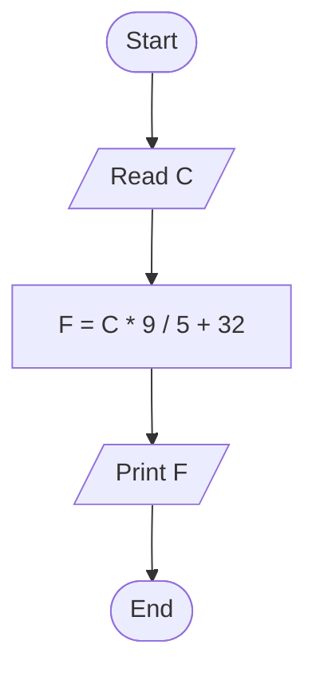
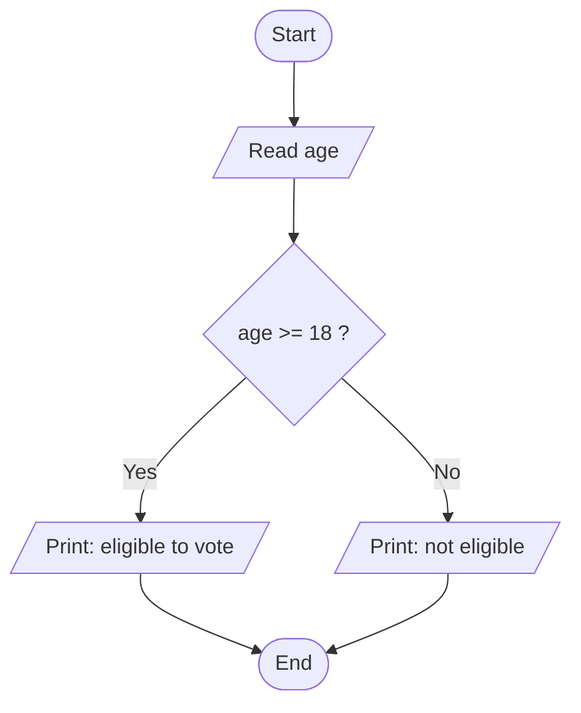
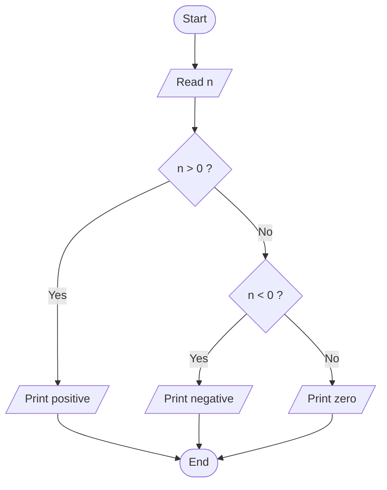
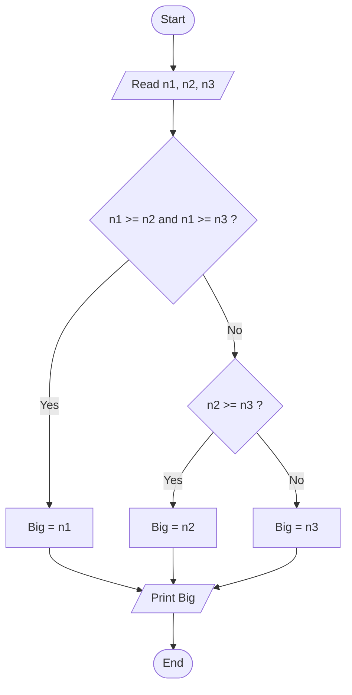
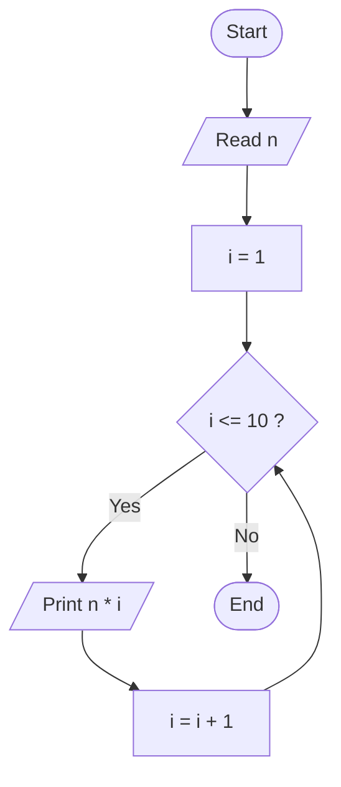
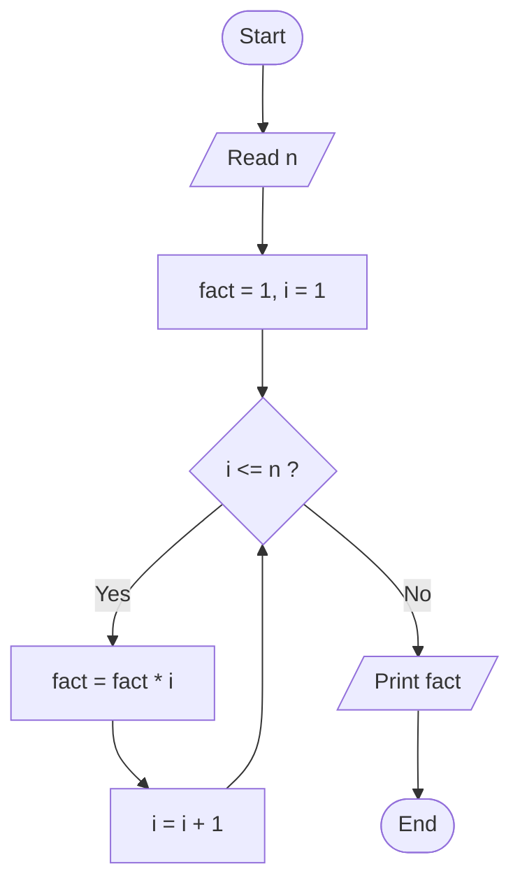
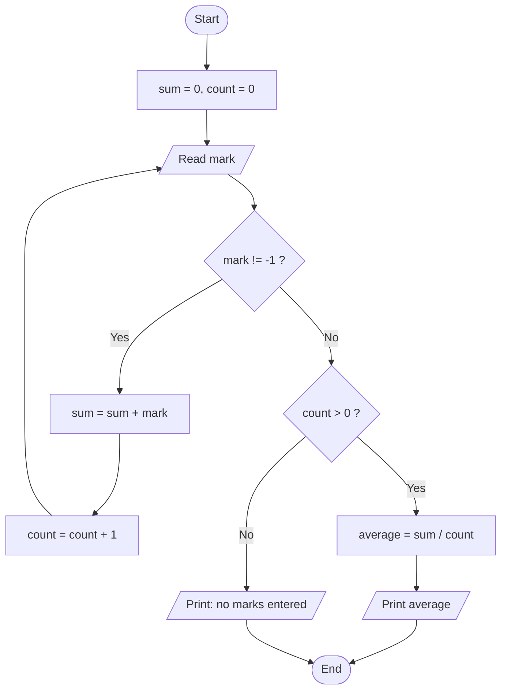
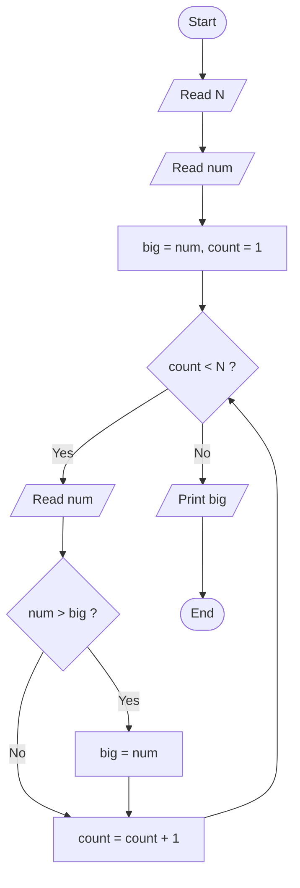

# Flowchart Exercises: Solutions

Attempt the exercises first. <br>
Many correct flowcharts exist; yours may differ and still be right.

## Exercise 1: Celsius to Fahrenheit

**Analysis**

- Input: C
- Process: F = C * 9 / 5 + 32
- Output: F

**Pseudocode**

```
Start
Read C
F ← C * 9 / 5 + 32
Print F
Stop
```

**Flowchart**



**Check with:** C = 100 gives 212. C = 0 gives 32.

## Exercise 2: Voting eligibility

**Analysis**

- Input: age
- Process: compare age with 18
- Output: a message

**Pseudocode**

```
Start
Read age
if age >= 18 then
    Print “eligible to vote”
else
    Print “not eligible”
Stop
```

**Flowchart**



**Check with:** Age 20: eligible. Age 17: not eligible. Age 18: eligible.

## Exercise 3: Positive, negative or zero

**Analysis**

- Input: n
- Process: test n > 0, then n \< 0
- Output: a message

**Pseudocode**

```
Start
Read n
if n > 0 then
    Print “positive”
else if n < 0 then
    Print “negative”
else
    Print “zero”
Stop
```

**Flowchart**



**Check with:** 5: positive. -3: negative. 0: zero.

## Exercise 4: Largest of three numbers

**Analysis**

- Input: n1, n2, n3
- Process: compare the numbers using >=
- Output: Big

**Pseudocode**

```
Start
Read n1, n2, n3
if n1 >= n2 and n1 >= n3 then
    Big ← n1
else if n2 >= n3 then
    Big ← n2
else
    Big ← n3
Print Big
Stop
```

**Flowchart**



**Check with:** (4, 9, 6) gives 9. (7, 7, 3) gives 7. (2, 2, 2) gives 2.

## Exercise 5: Multiplication table

**Analysis**

- Input: n
- Process: repeat for i = 1 to 10: n * i
- Output: ten products

**Pseudocode**

```
Start
Read n
i ← 1
while i <= 10
    Print n * i
    i ← i + 1
Stop
```

**Flowchart**



**Check with:** n = 3 prints 3, 6, 9, … 30.

## Exercise 6: Factorial

**Analysis**

- Input: n
- Process: multiply fact by each i from 1 to n
- Output: fact

**Pseudocode**

```
Start
Read n
fact ← 1, i ← 1
while i <= n
    fact ← fact * i
    i ← i + 1
Print fact
Stop
```

**Flowchart**



**Check with:** n = 5 gives 120. n = 0 gives 1.

## Exercise 7: Average of marks until -1

**Analysis**

- Input: marks, ended by -1
- Process: sum and count the marks, then average = sum / count
- Output: average or a message

**Pseudocode**

```
Start
sum ← 0, count ← 0
Read mark
while mark != -1
    sum ← sum + mark
    count ← count + 1
    Read mark
if count > 0 then
    average ← sum / count
    Print average
else
    Print “no marks entered”
Stop
```

**Flowchart**



**Check with:** 60, 80, 70, -1 gives 70. Only -1 gives “no marks entered”.

## Exercise 8: Largest of N numbers

**Analysis**

- Input: N, then N numbers
- Process: keep the largest so far (big) and compare each new number
- Output: big

**Pseudocode**

```
Start
Read N
Read num
big ← num, count ← 1
while count < N
    Read num
    if num > big then
        big ← num
    count ← count + 1
Print big
Stop
```

**Flowchart**



**Check with:** N = 4 with 12, 7, 19, 5 gives 19.
